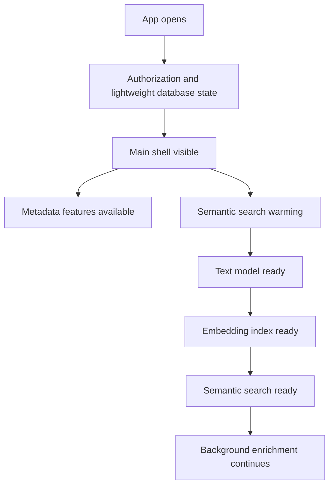

# Performance, Model Size, and Search Quality Optimization

## Summary

Memorable should become usable before every AI subsystem is fully warmed, reduce its initial install and on-device model footprint, and improve search quality through measured evaluation rather than ad hoc scoring changes. The optimization work should preserve the product's privacy promise: photos, videos, queries, and embeddings stay on device.

---

## Problem Frame

The current app treats AI readiness as launch readiness. Startup waits for the image encoder, the much larger text encoder, caption prompt preparation, and index loading before the main app appears. That makes the first visible experience depend on the slowest model and index path, even though several useful surfaces can run from lightweight database metadata.

The documented packaging story and the project configuration also diverge. The README says Core ML models are downloaded through On-Demand Resources, but the XcodeGen configuration bundles both compiled model folders directly as app resources. The local model payload is large: the text encoder is about 539 MB, the image encoder is about 176 MB, and the tokenizer is about 4 MB.

Search quality has a different risk profile. Smaller or lazy-loaded models can improve launch and install size, but compression, model replacement, prompt changes, and scoring changes can all degrade retrieval. Search optimization needs a benchmark before tuning.

---

## Key Decisions

- **Optimize perceived launch before total readiness.** The app shell should appear once authorization and lightweight state are ready; semantic search can warm in the background.
- **Separate delivery size from model compression.** On-Demand Resources or model download changes solve initial install size, while Core ML compression solves local storage and load cost.
- **Treat search quality as a measured system.** Model and scoring changes must be judged against a fixed query benchmark before shipping.
- **Stage enrichment behind core indexing.** Embeddings make items searchable; OCR, scene labels, geocoding, captions, and Surprise Me validation can complete later.
- **Keep privacy constraints non-negotiable.** Model download is acceptable, but photo content, queries, and embeddings must not leave the device.

---

## Requirements

**Launch and Readiness**

- R1. The main app shell must be able to render without the text encoder being loaded.
- R2. The app must distinguish app-shell readiness, indexing readiness, and semantic-search readiness as separate states.
- R3. Existing metadata-driven views must be available while AI models warm, when their data is already present in the database.
- R4. A semantic search submitted before the text encoder is ready must produce an explicit loading state rather than keeping the whole app on the splash screen.
- R5. Memory-warning recovery must keep the shell usable even if the semantic index is dropped and later rebuilt.

**Model Delivery and Size**

- R6. The project must have one truthful model packaging strategy: bundled, On-Demand Resources, or downloaded-and-compiled models.
- R7. If On-Demand Resources are used, each model resource must have a clear tag, request timing, progress/error behavior, and fallback behavior when the resource is unavailable.
- R8. If models are downloaded and compiled on device, the app must support resumable download, background compile, integrity validation, and a no-network fallback state.
- R9. Model compression must prioritize the text encoder first because it dominates the current model footprint.
- R10. Compressed or replacement models must not ship until they pass the search-quality gates in this document.

**Search Quality**

- R11. A local search evaluation set must exist before scoring, prompt, model, or compression changes are accepted.
- R12. The evaluation set must cover visual-only queries, date queries, location queries, mixed visual-date-location queries, OCR-heavy screenshot queries, negatives, videos, and common empty-result cases.
- R13. Search tuning must track ranking quality, empty-result quality, latency, and result diversity instead of relying only on manual spot checks.
- R14. Location and date handling must be evaluated separately from visual similarity so metadata improvements are not hidden by embedding score changes.
- R15. The search-scoring documentation must match the implemented pipeline before it is used as a tuning reference.

**Indexing and Background Work**

- R16. Base embeddings must become searchable before enrichment work runs.
- R17. OCR, scene classification, reverse geocoding, caption prompt preparation, and Surprise Me validation must be cancellable or deferrable background work.
- R18. Auto-resume indexing on launch must not compete with first paint or the first user-initiated search.
- R19. Surprise Me validation must avoid running many full-index semantic searches immediately after indexing when a cheaper validation path is available.
- R20. Large-library startup must avoid loading more embedding and GPU-index state than is needed for the first visible app state.

**User Experience and Reliability**

- R21. The user must see clear model/index readiness feedback only where it affects the action they are trying to take.
- R22. The app must keep non-search features available when semantic search is warming, unavailable, or recovering after memory pressure.
- R23. Optimization work must not weaken the existing privacy messaging or require accounts, analytics, or remote photo processing.

---

## Key Flows

- F1. Cold launch with an existing index
  - **Trigger:** The user opens the app after onboarding and photo authorization.
  - **Steps:** The app opens the shell, loads lightweight database state, exposes metadata-driven views, warms semantic search, and marks search ready when the text model and index are available.
  - **Outcome:** The user can navigate immediately, and semantic search becomes available without blocking the entire app.
  - **Covered by:** R1, R2, R3, R5, R20, R22.

- F2. First semantic search while models are warming
  - **Trigger:** The user enters a natural-language query before the text encoder is ready.
  - **Steps:** The search UI accepts the query, shows model/search readiness feedback, starts or awaits text-model readiness, then runs the search when ready.
  - **Outcome:** The app communicates the delay at the point of need instead of hiding the whole product behind startup loading.
  - **Covered by:** R1, R2, R4, R21.

- F3. First install with model resources not yet local
  - **Trigger:** The user installs the app and reaches a feature that requires a model resource.
  - **Steps:** The app requests the required model resource, shows progress and failure states, validates availability, then initializes the relevant encoder.
  - **Outcome:** Initial install size is reduced without producing a broken search or indexing experience.
  - **Covered by:** R6, R7, R8, R21, R23.

- F4. First indexing pass
  - **Trigger:** The user starts indexing a photo library or new unindexed media is discovered.
  - **Steps:** The app indexes base embeddings first, reloads searchable state, then schedules enrichment work at lower priority.
  - **Outcome:** Searchable coverage improves quickly, while quality enrichments arrive progressively.
  - **Covered by:** R16, R17, R18, R19.

---

## Acceptance Examples

- AE1. Cold launch no longer waits for the text model
  - **Covers:** R1, R2, R3.
  - **Given:** The user has completed onboarding and has an existing database.
  - **When:** The app is opened cold.
  - **Then:** The shell renders before text-encoder initialization finishes, and search-specific readiness is shown only in search surfaces.

- AE2. Search during warmup is handled locally
  - **Covers:** R4, R21, R23.
  - **Given:** The text model is not ready.
  - **When:** The user submits a visual query.
  - **Then:** The query waits locally for semantic readiness and no query text is sent to a remote service.

- AE3. Model delivery state is truthful
  - **Covers:** R6, R7, R8.
  - **Given:** A required model resource is not present on device.
  - **When:** The user starts a model-dependent action.
  - **Then:** The app requests or downloads the model through the chosen packaging strategy and shows a recoverable failure state if it cannot become available.

- AE4. Compression cannot pass on size alone
  - **Covers:** R9, R10, R11, R13.
  - **Given:** A compressed text encoder is smaller than the current model.
  - **When:** It is evaluated against the benchmark.
  - **Then:** It is rejected if ranking quality or empty-result behavior regresses beyond the agreed threshold.

- AE5. Indexing makes photos searchable before enrichment
  - **Covers:** R16, R17, R18, R19.
  - **Given:** A batch of new photos is being indexed.
  - **When:** Base embeddings are written.
  - **Then:** Those photos become searchable before OCR, scene labels, reverse geocoding, captions, and Surprise Me validation finish.

---

## Success Criteria

- The app shell reaches first visible interaction within a measured target on supported devices without waiting for both Core ML encoders.
- The initial install payload excludes large model resources if the chosen strategy is On-Demand Resources or downloaded models.
- The local model footprint is reduced by a measured percentage after compression experiments without breaching search-quality gates.
- First semantic search latency is measured separately for cold-model and warm-model cases.
- Search benchmark results track at least top-k relevance, empty-result correctness, location/date correctness, and latency.
- Background enrichment does not start work that materially delays first paint or the first user-initiated search.

---

## Scope Boundaries

**Deferred for later**

- Replacing SigLIP2 with a different model family is allowed as an experiment, but not required for the first optimization pass.
- Approximate nearest-neighbor search can be considered for very large libraries after launch and model-size work is measured.
- New memories features such as photo stories, maps, and calendar memories can benefit from this work, but they are not part of this optimization scope.

**Outside this product's identity**

- Remote embedding generation for user photos is out of scope.
- Remote query processing is out of scope.
- Analytics-dependent quality tuning is out of scope unless it can be done without collecting user photo, query, or embedding data.

---

## Dependencies and Assumptions

- The app continues to target iOS 17 and A14-or-newer devices unless product requirements change.
- The current text encoder is the largest model-size target based on local model folder sizes.
- The database can support metadata-only views and staged readiness without requiring a full semantic index at app shell time.
- The model packaging decision may depend on App Store distribution constraints, local development workflow, and whether compiled model folders or source model packages are distributed.
- Quality evaluation requires curated local test data or a deterministic fixture set that does not rely on user private libraries.

---

## Outstanding Questions

**Resolve Before Planning**

- What are the target launch metrics for supported devices: first shell render, search-ready time, and first query latency?
- What is the target initial install size, and should the App Store base app exclude both models or only the text model?
- What quality-regression threshold is acceptable for compressed models?

**Deferred to Planning**

- Should caption category embeddings be precomputed at build time or generated lazily after text-model readiness?
- Should metadata-only search support date and location queries before semantic search warms?
- Should Surprise Me validation use cached scene/location distributions, batched embedding queries, or lazy validation at interaction time?

---

## Sources and Research

- `Memorable/MemorableApp.swift` currently loads image and text encoders, prepares captions, then loads the index during app initialization.
- `Memorable/Views/ContentView.swift` gates the main tab view on `isModelLoaded`.
- `project.yml` bundles both compiled SigLIP2 model folders as app resources.
- `Memorable/Core/TextEncoder.swift` loads `SigLIP2_TextEncoder.mlmodelc` and the tokenizer during text encoder initialization.
- `Memorable/Core/ImageEncoder.swift` loads `SigLIP2_ImageEncoder.mlmodelc` during image encoder initialization.
- `Memorable/Core/PhotoCaptionService.swift` pre-encodes category prompts through the text encoder.
- `Memorable/Core/SearchEngine.swift` loads all photo and video embeddings and builds GPU search indexes in one load path.
- `Memorable/Core/IndexingService.swift` auto-loads existing index state, auto-resumes incomplete indexing, and launches enrichment work.
- `Memorable/Core/SurpriseQueries.swift` validates candidate queries by running full searches across the index.
- `SEARCH_SCORING.md` no longer matches the current search implementation and should not be used as a tuning source until refreshed.
- Apple Developer Documentation: [Reducing the Size of Your Core ML App](https://developer.apple.com/documentation/coreml/reducing-the-size-of-your-core-ml-app).
- Apple Developer Documentation: [NSBundleResourceRequest](https://developer.apple.com/documentation/foundation/nsbundleresourcerequest?changes=__4).
- Core ML Tools Guide: [Quantization Algorithms](https://apple.github.io/coremltools/docs-guides/source/opt-quantization-algos.html).
- Core ML Tools Guide: [Palettization Overview](https://apple.github.io/coremltools/docs-guides/source/opt-palettization-overview.html).
- Core ML Tools Guide: [Combining Compression Types](https://apple.github.io/coremltools/docs-guides/source/opt-joint-compression.html).
