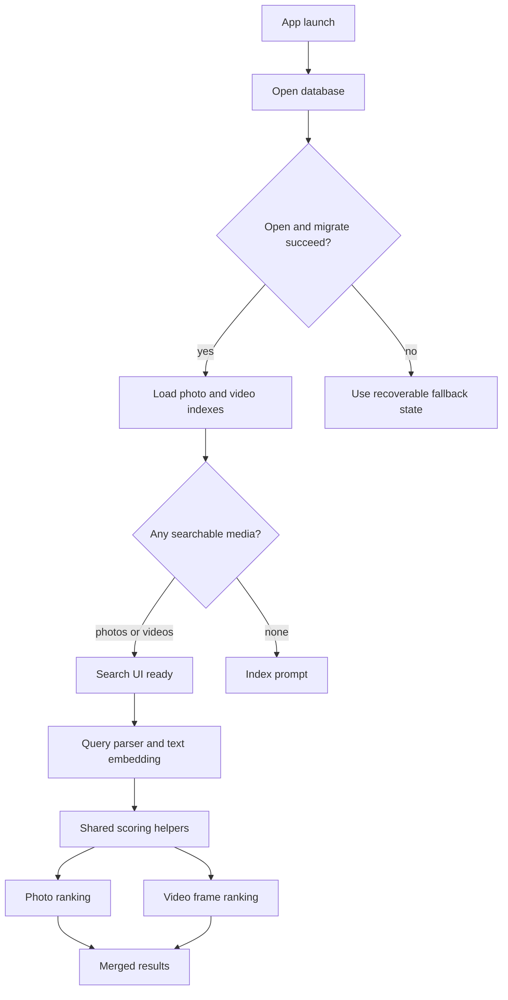
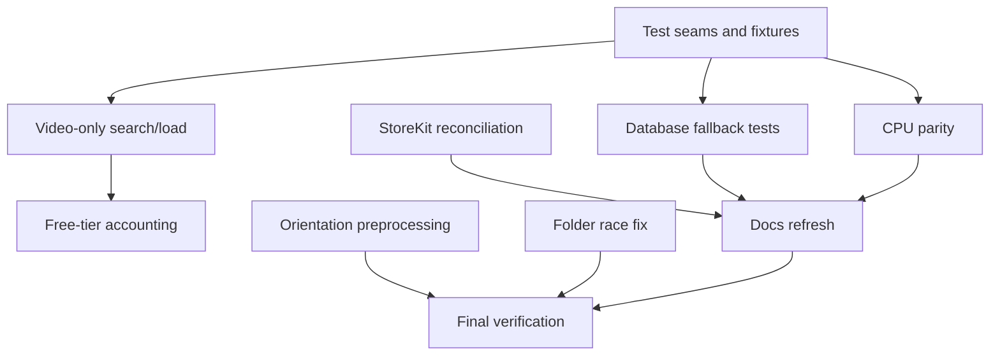

# fix: Harden search, purchases, and indexing

## Summary

This plan addresses the review findings as one hardening pass across search correctness, StoreKit release readiness, database failure handling, CPU/simulator parity, indexing policy, image preprocessing, docs, and regression coverage. The implementation should preserve the current product direction: on-device media search, bundled SigLIP2 models, and a `pro.v2` StoreKit product unless App Store Connect proves that identifier is wrong during implementation.

---

## Problem frame

The project has strong local patterns for privacy, embedding validation, PHImageManager continuations, and parser/config testing, but several higher-risk paths are either untested or currently inconsistent. The main user-visible risk is that video-only media can be indexed but not searched. The main release risk is that the code and StoreKit test configuration disagree on the Pro product identifier. The main operational risk is that database migration failure is logged without moving the app into the documented storage-warning fallback.

Local verification is currently blocked by the machine setup: `xcodebuild test` cannot find the requested simulator and reports missing/out-of-date iOS platform support. This plan treats that as an environment prerequisite, not an app-code defect.

---

## Requirements

- R1. A library with only indexed videos must become searchable, including normal visual queries and pure location/date paths where metadata is available.
- R2. Existing indexes must load when either photos or videos exist, and UI readiness must not depend on photo count alone.
- R3. StoreKit product identifiers must be consistent across code, local StoreKit configuration, tests, and documentation.
- R4. Database open and migration failures must produce an explicit recoverable fallback state instead of leaving an unusable queue behind.
- R5. CPU and simulator search paths must preserve the same user-facing semantics as the GPU path for fallback results and negative video terms.
- R6. Free-tier accounting must apply to the intended media unit consistently across photos and videos.
- R7. Image embeddings must be generated from orientation-correct pixels for PhotoKit and folder images.
- R8. Folder indexing must mark itself running synchronously so duplicate starts cannot race.
- R9. README and agent guidance must match the current implementation for free-tier size, StoreKit product ID, SigLIP2 raw query encoding, result limits, and setup requirements.
- R10. Regression tests must cover the high-risk paths identified in the review before this work is considered complete.
- R11. Repo-local Compound Engineering configuration must be bootstrapped safely without installing global tools as part of app hardening.

---

## Key technical decisions

- KTD1. Preserve `com.blockdeep.memorable.pro.v2` as the planned StoreKit identifier: the code already points at v2, and changing it back could silently break App Store Connect configuration if v2 is the intended live product. The implementation must verify App Store Connect or project history before changing the code identifier.
- KTD2. Introduce narrow test seams only where current concrete dependencies block regression coverage: `DatabaseProtocol` already exists, but `SearchEngine` needs a deterministic text-embedding seam for unit tests without loading Core ML.
- KTD3. Prefer shared scoring helpers over duplicated CPU/GPU branches: CPU fallback, video negative-term penalties, fallback results, and tests should call the same dot-product/ranking primitives where practical.
- KTD4. Treat migration failure as a storage availability problem: the app should swap to an in-memory queue and show the existing storage warning. Continuing on a failed migration is not acceptable, and a storage error screen would be worse than the existing recoverable fallback pattern.
- KTD5. Keep global tool installation out of the app fix plan: repo-local `.compound-engineering` config can be committed, while `agent-browser`, `gh`, `vhs`, `silicon`, and `ast-grep` installation remains developer-machine setup.
- KTD6. Use characterization-first sequencing for risky behavior: add deterministic tests around the broken or uncovered behavior before changing search, StoreKit, database, and preprocessing code.
- KTD7. Keep embedding preprocessing versions consistent: if orientation normalization changes the image bytes that feed SigLIP2, add an index invalidation path so old and new embeddings are not mixed in one search index.

---

## High-level technical design

### Runtime correctness flow

### Delivery sequencing

---

## Implementation units

### U1. Add deterministic test seams for search and indexing

- **Goal:** Make the high-risk search/indexing behaviors testable without loading Core ML models or PhotoKit media.
- **Requirements:** R1, R2, R5, R6, R10
- **Dependencies:** None
- **Files:** `Memorable/Core/TextEncoder.swift`, `Memorable/Core/SearchEngine.swift`, `MemorableTests/SearchEngineTests.swift`, `MemorableTests/IndexingPolicyTests.swift`
- **Approach:** Introduce a narrow text-embedding abstraction that `TextEncoder` implements and tests can fake. Keep the production initializer behavior unchanged. Add compact in-memory fixtures for `DatabaseProtocol` that can return photo-only, video-only, mixed, and corrupted embedding indexes.
- **Execution note:** Start with tests that demonstrate the current video-only and CPU-fallback gaps.
- **Patterns to follow:** Existing `DatabaseProtocol` injection in `SearchEngine`; simple XCTest style in `DataModelTests` and `SearchConfigTests`.
- **Test scenarios:**
  - A fake text encoder returns a deterministic normalized query embedding, and `SearchEngine` uses it without touching Core ML.
  - A fake database with one valid photo row and one valid video frame loads without corrupting metadata alignment.
  - A fake database with an invalid embedding byte count is skipped by database loading and does not enter the search matrix.
  - A fake database with mismatched metadata and embedding rows causes `SearchEngineError.corruptedIndex`.
- **Verification:** Implementers can write search and indexing policy tests that run as normal unit tests without model files, Photos authorization, or a simulator GPU.

### U2. Fix video-only index loading and search

- **Goal:** Make videos first-class searchable media even when no photos are indexed.
- **Requirements:** R1, R2, R10
- **Dependencies:** U1
- **Files:** `Memorable/Core/SearchEngine.swift`, `Memorable/Core/IndexingService.swift`, `Memorable/Views/SearchView.swift`, `MemorableTests/SearchEngineTests.swift`, `MemorableTests/IndexingServiceTests.swift`
- **Approach:** Replace photo-only readiness checks with total searchable media checks. Let the search path run video scoring when photo count is zero. Adjust existing-index loading so it loads and marks ready when either indexed photos or indexed videos exist. Keep UI counts based on `totalSize` so user copy reflects both media types.
- **Patterns to follow:** Existing `SearchEngine.totalSize`, `videoSize`, and `uniqueVideoCount`; existing video dedup map in the search pipeline.
- **Test scenarios:**
  - Given zero photos and one indexed video frame above threshold, a visual query returns one video result.
  - Given zero photos and one indexed video with matching location strings, a pure location query returns the video result.
  - Given zero photos and one indexed video outside a date filter, the query returns no main result.
  - Given an existing video-only database, index loading marks the service ready and exposes the video count.
  - Given mixed photos and videos, existing behavior still merges and sorts results by score with recency tie-breaks.
- **Verification:** Video-only fixtures are searchable in unit tests, and the UI readiness path no longer depends on `indexedCount()` alone.

### U3. Reconcile StoreKit product identity

- **Goal:** Make Pro purchase loading, restore, refund handling, StoreKit testing, and docs use one product ID.
- **Requirements:** R3, R9, R10
- **Dependencies:** None
- **Files:** `Memorable/Core/ProFeatures.swift`, `Memorable/Store/MemorableProducts.storekit`, `MemorableTests/StoreKitConfigTests.swift`, `README.md`, `CLAUDE.md`, `AGENTS.md`
- **Approach:** Preserve `com.blockdeep.memorable.pro.v2` as the intended ID unless App Store Connect or git history proves otherwise. Update the local StoreKit config to match. Add a test that parses the StoreKit JSON and asserts the configured product exists for `ProManager.productId`.
- **Patterns to follow:** Existing `AppConstantsTests` style for stable constants; StoreKit 2 verification pattern already used in `ProManager`.
- **Test scenarios:**
  - The StoreKit config contains exactly the Pro product ID used by `ProManager`.
  - The StoreKit config product is a non-consumable and remains family-shareable if that remains the intended product setting.
  - Restore entitlement logic ignores transactions for unrelated product IDs.
  - Refund/revocation handling still calls the trim callback for the configured Pro product.
- **Verification:** Local StoreKit testing can load the Pro product, and docs no longer mention the old product ID.

### U4. Make database migration failure recoverable

- **Goal:** Ensure migration failure cannot leave the app running against a partially unusable on-disk database.
- **Requirements:** R4, R10
- **Dependencies:** U1
- **Files:** `Memorable/Core/Database.swift`, `Memorable/Views/SearchView.swift`, `MemorableTests/DatabaseTests.swift`
- **Approach:** Refactor database queue creation and migration into a small testable path that can fall back when migration throws. Reuse the existing `AppDatabase.isInMemoryFallback` UI warning so users understand that the index will not persist. Avoid `fatalError` and preserve the current successful migration behavior.
- **Patterns to follow:** Existing in-memory fallback in `openDatabase`; existing storage-warning banner in `SearchView`.
- **Test scenarios:**
  - When opening the on-disk database fails, the database uses an in-memory queue and marks fallback.
  - When migration throws, the database uses an in-memory queue or exposes a recoverable storage error instead of returning the failed queue.
  - When migration succeeds, the fallback flag remains false and normal CRUD operations work.
  - The storage warning appears when the fallback flag is true.
- **Verification:** A simulated migration failure is covered by unit tests and results in the same recoverable user-facing storage state as an open failure.

### U5. Unify CPU and GPU search semantics

- **Goal:** Make simulator and CPU fallback behavior match device GPU semantics for fallback results and negative video terms.
- **Requirements:** R5, R10
- **Dependencies:** U1
- **Files:** `Memorable/Core/SearchEngine.swift`, `Memorable/Core/GPUSimilaritySearch.swift`, `MemorableTests/SearchEngineTests.swift`
- **Approach:** Extract shared score computation and ranking helpers inside the search layer. Use CPU dot products when GPU search is unavailable for photo fallback results and video negative-term penalties. Keep GPU as the fast path on device, but require identical result semantics.
- **Patterns to follow:** Existing vDSP dot-product loops in photo scoring, video scoring, and `findSimilar`.
- **Test scenarios:**
  - With GPU unavailable, fallback results are still generated from CPU scores.
  - With GPU unavailable, a negative term lowers video frame scores.
  - With mixed media, CPU and fake-GPU score arrays produce the same result ordering for the same inputs.
  - Near-miss fallback remains capped and filtered as currently intended.
- **Verification:** Search tests pass under simulator/CPU conditions without requiring `GPUSimilaritySearch`.

### U6. Clarify and enforce free-tier media accounting

- **Goal:** Apply the free-tier limit consistently to the intended indexed item count.
- **Requirements:** R6, R9, R10
- **Dependencies:** U1, U2
- **Files:** `Memorable/Core/IndexingService.swift`, `Memorable/Core/ProFeatures.swift`, `MemorableTests/IndexingPolicyTests.swift`, `README.md`, `CLAUDE.md`, `AGENTS.md`
- **Approach:** Decide and encode whether the limit is total indexed media or photos only. The review finding points to total media because UI copy says photos and videos and refund trimming trims both. Implement a small policy helper so tests can validate existing-photo, existing-video, and mixed-library counts without constructing `PHAsset` values.
- **Patterns to follow:** Existing `trimToLimit` proportional allocation; existing `FreeTier.maxPhotos` constant, with naming updated if it becomes total media.
- **Test scenarios:**
  - A free user with 499 photos and 1 video is at the limit and does not index more media.
  - A free user with 0 photos and 500 videos is at the limit if the policy is total media.
  - A Pro user ignores the limit and continues indexing.
  - Refund trimming keeps the newest media within the configured limit across photos and videos.
- **Verification:** Limit behavior is covered by pure unit tests and matching docs copy.

### U7. Normalize image orientation before embedding

- **Goal:** Ensure embeddings represent the image as users see it, not raw pixel orientation.
- **Requirements:** R7, R10
- **Dependencies:** U4
- **Files:** `Memorable/Core/ImageEncoder.swift`, `Memorable/Core/FolderScanner.swift`, `Memorable/Core/Database.swift`, `MemorableTests/ImagePreprocessingTests.swift`, `MemorableTests/DatabaseTests.swift`
- **Approach:** Normalize or render `UIImage` orientation before writing pixels into the Core ML input buffer. Apply the same orientation-safe path to folder images, while preserving existing SigLIP2 normalization and 224x224 target size. If tests prove that existing embeddings would change, add a migration or version marker that clears stale embeddings, following the existing SigLIP2 model-swap invalidation pattern.
- **Patterns to follow:** Existing `UIImage.toPixelBuffer` preprocessing helper; folder thumbnail transform behavior in `FolderScanner`; `v2-siglip2-model-swap` data invalidation in `Database`.
- **Test scenarios:**
  - A test image with a non-up orientation produces the same pixel layout as the visually equivalent upright image.
  - A folder image with EXIF orientation is resized and embedded from the transformed pixels.
  - Existing upright images produce unchanged dimensions and valid pixel buffers.
  - Invalid or empty images still fail gracefully with `preprocessingFailed`.
  - If orientation normalization invalidates existing embeddings, the migration clears stale indexed photos and videos so the search index is homogeneous.
- **Verification:** Orientation fixture tests pass without Core ML inference, and any required invalidation is covered by database migration tests.

### U8. Close the folder-indexing start race

- **Goal:** Prevent duplicate folder indexing starts from slipping in before progress state changes.
- **Requirements:** R8, R10
- **Dependencies:** None
- **Files:** `Memorable/Core/IndexingService.swift`, `MemorableTests/IndexingServiceTests.swift`
- **Approach:** Match `startIndexing()` and `indexNewPhotosOnly()` by marking `progress.isRunning` before launching folder indexing work. Ensure early failures clear running state so the UI does not get stuck.
- **Patterns to follow:** Existing main-actor `IndexingService` state mutation style.
- **Test scenarios:**
  - Calling folder indexing once marks progress running immediately.
  - Calling folder indexing twice while running starts only one task.
  - Failure to acquire security-scoped access clears the running state.
- **Verification:** The race is covered by a unit-level state test or a small extracted state helper if direct task testing is too coupled to UIKit.

### U9. Refresh documentation and repository-local CE setup

- **Goal:** Bring project guidance in line with implementation and add safe Compound Engineering repo config.
- **Requirements:** R3, R9, R11
- **Dependencies:** U3, U4, U5, U6
- **Files:** `README.md`, `CLAUDE.md`, `AGENTS.md`, `.gitignore`, `.compound-engineering/config.local.example.yaml`
- **Approach:** Update stale references to prompt fusion, top-50-only behavior, 200-item free tier, and old StoreKit product ID. Add the CE config example from the installed plugin template and gitignore local CE config files. Do not install missing global tools as part of the repo plan.
- **Patterns to follow:** Existing `.gitignore` sections for local tool state; existing project docs structure.
- **Test scenarios:** Test expectation: none -- documentation and repo-local config only. The StoreKit and free-tier assertions are covered by U3 and U6 tests.
- **Verification:** Docs agree with code constants and the CE setup diagnostic no longer reports missing example config or unsafe local config tracking.

### U10. Run final verification and record local environment notes

- **Goal:** Verify the full hardening pass and document any remaining local setup blockers.
- **Requirements:** R10, R11
- **Dependencies:** U1, U2, U3, U4, U5, U6, U7, U8, U9
- **Files:** `README.md`
- **Approach:** Run the relevant unit-test and build suite after the local Xcode/iOS simulator platform issue is fixed. If the platform is still unavailable, document the exact blocker rather than presenting verification as complete. Keep this unit as validation and docs cleanup, not a code feature.
- **Patterns to follow:** Existing Build & Run section in `README.md`; project guidance in `CLAUDE.md`.
- **Test scenarios:** Test expectation: none -- this unit verifies prior behavioral tests and updates environment notes only.
- **Verification:** The project builds and tests on the documented simulator or the README names the current required platform/device setup accurately.

---

## Scope boundaries

### In scope

- Fixing the reviewed correctness and release-readiness issues.
- Adding regression coverage for search, indexing policy, StoreKit config, database fallback, and preprocessing.
- Updating repo docs and local CE config scaffolding.

### Deferred work

- Installing global developer tools reported missing by `ce-setup`: `agent-browser`, `gh`, `vhs`, `silicon`, `ast-grep`, and the global `ast-grep` skill.
- Updating the local macOS/Xcode/iOS simulator installation so `xcodebuild test` can run.
- Broader search quality tuning beyond preserving intended existing scoring semantics.

### Out of scope

- New search features, new monetization models, subscriptions, analytics, cloud sync, or server-side purchase validation.
- Replacing SigLIP2, changing model dimensions, or changing the app's on-device privacy posture.

---

## Planning assumptions

- App Store Connect either already has `com.blockdeep.memorable.pro.v2` configured or the implementation will discover that mismatch before shipping.
- The free-tier limit applies to total indexed media items, not photos only. If product policy says otherwise, U6 should update naming and docs instead of changing behavior silently.
- A local config example is safe to commit, but machine-local CE preferences and global tool installation are outside this repo artifact.
- Installing compatible Xcode/iOS simulator support is required before final verification can be completed locally.

---

## Acceptance examples

- AE1. Given a user has only indexed videos, when they search for a visual concept matching one frame, then the results grid shows the matching video.
- AE2. Given the StoreKit config is selected in the scheme, when the upgrade view loads products, then it can find the same product ID that `ProManager` requests.
- AE3. Given database migration fails at launch, when the app initializes, then the UI shows the storage warning and the app remains usable with an in-memory index.
- AE4. Given the app runs on simulator without GPU search, when a query has fallback or negative-term behavior, then the same semantic result class appears as on device.
- AE5. Given a free user has already indexed the maximum allowed media count across photos and videos, when indexing resumes, then no additional media is indexed until Pro unlocks.
- AE6. Given a rotated image, when it is preprocessed for embedding, then the pixel buffer matches the displayed orientation.

---

## System-wide impact

This plan touches the core search pipeline, indexing lifecycle, purchase unlock state, persistence failure behavior, and project documentation. The most important cross-cutting invariant is that UI readiness, counts, free-tier enforcement, refund trimming, and search behavior all use the same definition of indexed media. The second invariant is that simulator/CPU behavior remains useful for verification even when device GPU acceleration is unavailable.

---

## Risks and dependencies

- **StoreKit source of truth:** The plan assumes `com.blockdeep.memorable.pro.v2` is intended. Implementation must verify App Store Connect or project history before shipping a product ID change.
- **Test seam scope:** Introducing a text-encoding protocol is justified for tests, but it should stay narrow and avoid a broader encoder abstraction.
- **Database fallback trade-off:** In-memory fallback preserves app launch but loses persistence. The UI warning must remain visible and accurate.
- **Image preprocessing sensitivity:** Orientation fixes can change embeddings for existing indexed media. Mitigation: U7 must either prove no existing embedding inputs change or add an invalidation path so old and new embeddings are not mixed.
- **Policy drift:** Free-tier count, product ID, and README copy have already drifted once. Mitigation: U3 and U6 add tests that bind docs/config to code-level constants where feasible.
- **Environment dependency:** Full test verification depends on installing compatible iOS simulator/platform support locally.

---

## Sources and research

- Local review findings from `Memorable/Core/SearchEngine.swift`, `Memorable/Core/IndexingService.swift`, `Memorable/Core/Database.swift`, `Memorable/Core/ProFeatures.swift`, `Memorable/Store/MemorableProducts.storekit`, `Memorable/Core/ImageEncoder.swift`, `Memorable/Core/FolderScanner.swift`, `README.md`, `CLAUDE.md`, and existing `MemorableTests`.
- Apple StoreKit documentation: `Transaction.currentEntitlements` provides current entitlement transactions for non-consumables and omits refunded or revoked products, supporting the existing entitlement verification shape. See [Apple Developer Documentation](https://developer.apple.com/documentation/storekit/transaction/currententitlements?changes=_7).
- Apple Xcode StoreKit testing documentation: local StoreKit configuration files are the supported way to define or sync products for Xcode purchase testing, so the checked-in `.storekit` file must match the product IDs requested by code. See [Apple Developer Documentation](https://developer.apple.com/documentation/xcode/setting-up-storekit-testing-in-xcode).
