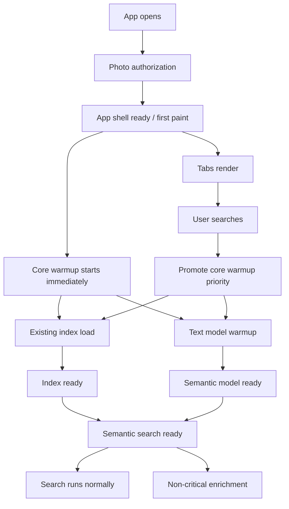
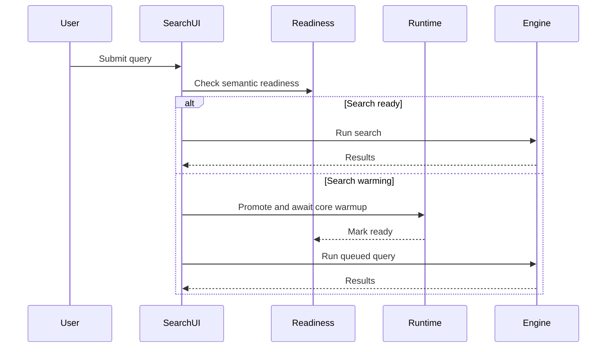

# perf: Stage launch readiness and search optimization

## Summary

This plan turns the brainstorm into a staged implementation roadmap. The first implementation slice makes the app shell usable before all AI systems are warm, immediately starts core semantic-search warmup after first paint, adds measurement around launch/search/indexing readiness, and defers only non-critical enrichment plus heavier model packaging and compression work until the app has a reliable performance baseline.

---

## Problem frame

Memorable currently treats model readiness as app readiness. `Memorable/MemorableApp.swift` initializes the image encoder, text encoder, caption category embeddings, search engine, and existing index before `Memorable/Views/ContentView.swift` can render `MainTabView`. That blocks every post-onboarding surface on the slowest AI and index path, even though metadata-backed surfaces and non-search UI do not need the text model.

The optimization target is not blanket laziness. Core search prerequisites should move out of the splash-screen path, then begin immediately after the shell paints and be promoted when a user searches. Only work that does not make the first semantic query possible, such as enrichment, prompt preparation, validation sweeps, and automatic resume work, should be delayed behind the core search path.

The brainstorm also identified a packaging mismatch: `README.md` describes On-Demand Resources, but `project.yml` bundles both compiled SigLIP2 `.mlmodelc` folders as resources. The text encoder dominates the local footprint, so any model-size work must be measured against search quality before it ships.

---

## Requirements

**Launch and Readiness**

- R1. The main app shell renders after photo authorization and lightweight app state, without waiting for text-encoder initialization.
- R2. App-shell readiness, index readiness, and semantic-search readiness are represented as separate states.
- R3. Metadata-driven and non-search surfaces remain available while semantic search warms.
- R4. Search submitted before semantic readiness produces a local readiness/loading state instead of returning silently or blocking app launch.
- R5. Memory-warning recovery keeps the shell available and reloads semantic search state on demand.
- R6. Core semantic search warmup starts immediately after first shell render; it is not deferred until the first search.

**Measurement and Quality**

- R7. Launch, search readiness, first-query latency, indexing throughput, and UI responsiveness timings are captured in DEBUG logs or a testable local metrics recorder.
- R8. A local search evaluation harness exists before model compression, model replacement, or scoring changes are accepted.
- R9. Search evaluation covers visual, date, location, mixed visual-date-location, OCR, negative, video, and empty-result cases.
- R10. Search scoring documentation matches the implemented pipeline before it is used for tuning.
- R11. Startup optimization is not accepted if first semantic query latency, warm search latency, indexing throughput, or search quality regresses beyond agreed budgets.

**Indexing and Background Work**

- R12. Existing-index loading and auto-resume indexing do not block first shell render.
- R13. Existing-index loading starts immediately after shell render at controlled priority and can be promoted by user search intent.
- R14. Base embeddings become searchable before enrichment work runs.
- R15. Caption prompt preparation, geocoding, OCR/scene enrichment, and Surprise Me validation are non-critical enrichment work and are deferrable or cancellable.
- R16. Surprise Me validation avoids immediate many-query full-index validation when a cheaper or delayed path is available.

**Model Delivery and Size**

- R17. The project records one truthful model packaging strategy before changing distribution behavior.
- R18. Model packaging changes preserve recoverable unavailable-resource states for model-dependent actions.
- R19. Text-encoder compression or replacement is evaluated against the search benchmark before shipping.

**Privacy and Product Constraints**

- R20. User photos, videos, queries, and embeddings remain on device throughout the optimization work.
- R21. Remote photo embedding, remote query processing, and analytics-dependent search tuning remain out of scope.

---

## Key technical decisions

- **Stage readiness before model delivery.** The first implementation slice should split readiness state and add metrics before On-Demand Resources or compression work. This reduces launch risk and creates the baseline needed to judge later changes.
- **Keep the search engine optional at shell time.** `MainTabView` and search surfaces should tolerate semantic search not being ready yet, rather than requiring a concrete loaded `SearchEngine` before tab rendering.
- **Warm core semantic search immediately after first paint.** The text encoder and existing search index should stop blocking the splash path, but they should start warming as soon as the shell is visible. Search intent should promote this work ahead of enrichment.
- **Defer enrichment, not core search.** Caption prompt preparation, geocoding, OCR/scene enrichment, and Surprise Me validation can move later because they improve result quality or product polish after base embeddings are searchable. The core text model and base index should not be deferred indefinitely.
- **Make quality measurement a dependency of compression.** Compression may reduce size but can alter ranking quality. The benchmark and stale scoring-doc refresh must land before compression experiments are treated as shippable.
- **Defer model packaging strategy to a planned experiment.** Apple-supported options include On-Demand Resources and downloaded-and-compiled models. The app should first expose recoverable model-unavailable behavior before switching packaging.

---

## High-level technical design

### Readiness state flow



### Search submission while warming



---

## Implementation units

### U1. Add the readiness and metrics model

**Goal:** Introduce testable readiness state and local timing metrics without changing user-facing behavior yet.

**Requirements:** R1, R2, R5, R7.

**Dependencies:** None.

**Files:**

- `Memorable/Core/AppReadiness.swift`
- `Memorable/Core/PerformanceMetrics.swift`
- `Memorable/Core/AppConstants.swift`
- `MemorableTests/AppReadinessTests.swift`
- `MemorableTests/PerformanceMetricsTests.swift`

**Approach:** Add small value types or enums that describe shell, index, semantic model, and semantic search readiness. Add a lightweight metrics recorder that can record named durations for launch phases, post-paint semantic warmup, first-query latency, warm-query latency, indexing throughput, and main-thread responsiveness in DEBUG, while staying harmless in production. Keep it independent of Core ML so tests can run without model files.

**Patterns to follow:** `IndexingProgress` in `Memorable/Core/DataModels.swift` for compact state modeling, `AppKeys` and config constants in `Memorable/Core/AppConstants.swift`, and existing unit-test style in `MemorableTests/AppConstantsTests.swift`.

**Test scenarios:**

- New app readiness starts with shell, index, and semantic search unavailable.
- Marking shell ready does not imply index or semantic search readiness.
- Marking semantic model ready without index ready does not mark semantic search ready.
- Marking both semantic model and index ready marks semantic search ready.
- Metrics recorder stores a completed duration when a phase is started then ended.
- Metrics recorder can distinguish shell readiness, semantic readiness, first query, warm query, and indexing phases.
- Ending an unknown metrics phase is ignored or reported without crashing.

**Verification:** Readiness state can be exercised entirely from unit tests, and DEBUG metrics calls can be added later without importing Core ML or Photos.

### U2. Render the shell before semantic search is ready

**Goal:** Refactor app initialization so `ContentView` can render the main tabs after authorization and lightweight shell readiness.

**Requirements:** R1, R2, R3, R5, R6, R7.

**Dependencies:** U1.

**Files:**

- `Memorable/MemorableApp.swift`
- `Memorable/Views/ContentView.swift`
- `Memorable/Views/MainTabView.swift`
- `MemorableTests/AppReadinessTests.swift`

**Approach:** Replace the single `isModelLoaded` gate with readiness state from U1. `AppState.initialize()` should request photo authorization, make the shell available, and then immediately begin core semantic warmup asynchronously after first paint. `MainTabView` should accept optional or readiness-gated search dependencies so non-search surfaces can render while semantic search warms.

**Execution note:** Add characterization tests around readiness transitions before changing the existing launch gate.

**Patterns to follow:** Existing `@MainActor AppState` ownership in `Memorable/MemorableApp.swift`, environment-object flow in `Memorable/Views/ContentView.swift`, and tab construction in `Memorable/Views/MainTabView.swift`.

**Test scenarios:**

- Covers AE1. After authorized initialization reaches shell readiness, content routing can choose the main app shell even if semantic search is unavailable.
- Authorization denied or restricted still routes to the photo-access-denied view.
- Initialization failure in later warmup records an error for model-dependent actions without hiding non-search shell state.
- Memory warning after shell readiness does not reset shell readiness.

**Verification:** The app no longer uses text-model readiness as the condition for showing `MainTabView`, and tests cover the state transition that enables shell-first rendering.

### U3. Introduce the post-paint semantic runtime

**Goal:** Move text-encoder and search-engine readiness into a semantic runtime that starts warming immediately after shell render and can be promoted by search.

**Requirements:** R2, R4, R5, R6, R7, R13, R15.

**Dependencies:** U1, U2.

**Files:**

- `Memorable/Core/SemanticSearchRuntime.swift`
- `Memorable/MemorableApp.swift`
- `Memorable/Core/SearchEngine.swift`
- `Memorable/Core/TextEncoder.swift`
- `Memorable/Core/PhotoCaptionService.swift`
- `MemorableTests/SemanticSearchRuntimeTests.swift`
- `MemorableTests/SearchEngineTests.swift`

**Approach:** Add an `@MainActor` runtime or service that owns text-encoder initialization, search-engine creation, index-load readiness, and enrichment scheduling boundaries. The runtime should expose readiness state, start core warmup after shell readiness, and offer an async way for search callers to promote and await semantic readiness. Caption preparation should become background-only enrichment so it cannot delay shell readiness or compete with first-query readiness.

**Technical design:** Directional lifecycle, not implementation syntax:

```text
idle -> postPaintCoreWarmup -> warmingTextModel -> textModelReady
textModelReady + indexReady -> semanticReady
semanticReady + memoryWarning -> indexDropped
indexDropped + foreground/searchRequest -> promotedWarmingIndex -> semanticReady
semanticReady -> enrichmentEligible
```

**Patterns to follow:** `SearchView` task cancellation around `searchTask`, `SearchEngine.dropIndex()` memory-pressure behavior, and `PhotoCaptionService.prepare(textEncoder:)` as the work to defer.

**Test scenarios:**

- Runtime warmup calls the injected text-encoder factory only once across concurrent waiters.
- Runtime starts core warmup after shell readiness without waiting for first search.
- Runtime reports warming while the text encoder or index loader is initializing.
- Runtime reports semantic readiness only after both text model and index readiness are available.
- Covers AE2. A search waiter promotes core warmup and receives readiness after warmup without remote processing.
- Caption preparation can fail without preventing semantic search readiness.
- Memory-warning recovery marks the index unavailable while preserving shell readiness.

**Verification:** Search runtime behavior is testable with fake factories and fake search/index loaders; no unit test requires actual model files.

### U4. Update the search UI for semantic warmup

**Goal:** Make the search screen communicate semantic readiness at the point of action and run a submitted query after warmup completes.

**Requirements:** R3, R4, R5, R11, R20.

**Dependencies:** U2, U3.

**Files:**

- `Memorable/Views/SearchView.swift`
- `Memorable/Views/MainTabView.swift`
- `Memorable/Views/IndexingBannerView.swift`
- `MemorableTests/SearchReadinessViewModelTests.swift`

**Approach:** Add a small view-model seam if needed so readiness behavior can be tested outside SwiftUI rendering. The search field should distinguish "no index yet", "semantic search warming", and "ready". Submitting a query during warmup should promote core warmup priority, preserve cancellation behavior for replaced queries, then run the latest query locally when ready.

**Patterns to follow:** Existing `searchTask` cancellation in `Memorable/Views/SearchView.swift`, current `isSearching` state rendering, and existing `IndexingBannerView` progress language.

**Test scenarios:**

- Search submit with no index still refuses search and shows index-building guidance.
- Search submit while semantic runtime is warming enters a warmup/searching state and promotes pending core warmup work.
- If the user submits query A, then query B before warmup completes, only query B lands results.
- If semantic warmup fails, the search surface shows a model-dependent error without clearing shell state.
- Covers AE2. Query text remains local and is only passed to the local semantic runtime/search engine.

**Verification:** Search UI state transitions are covered by unit tests or view-model tests, and manual inspection shows the search screen no longer depends on global splash-screen loading for semantic readiness.

### U5. Prioritize the core index load and defer enrichment

**Goal:** Protect first shell render while loading the existing base index promptly enough that first search does not regress, and defer only automatic indexing/enrichment work that is not required for base search.

**Requirements:** R11, R12, R13, R14, R15, R16, R21.

**Dependencies:** U1, U3.

**Files:**

- `Memorable/Core/IndexingService.swift`
- `Memorable/Core/SurpriseQueries.swift`
- `Memorable/Core/PhotoCaptionService.swift`
- `Memorable/Core/AppConstants.swift`
- `MemorableTests/IndexingPolicyTests.swift`
- `MemorableTests/SurpriseQueriesTests.swift`

**Approach:** Split "inspect existing index counts", "load semantic index", "auto-resume indexing", and "launch enrichment" into separately scheduled operations. Existing index load should start immediately after shell render at controlled priority, remain priority-aware, and be promotable by user search intent. Auto-resume indexing and enrichment should be delayed until after shell render and until the core search path has had a chance to settle.

**Patterns to follow:** Existing `IndexingStartPolicy`, `checkForIncompleteIndex`, `reloadSearchIndex`, and `Task.detached(priority: .utility)` usage for geocoding and Surprise Me validation.

**Test scenarios:**

- Existing indexed count can be detected without blocking shell render.
- Existing index load is scheduled after shell readiness and before non-critical enrichment.
- User-initiated search promotes pending existing-index load ahead of enrichment.
- Auto-resume policy does not mark indexing running before the configured post-launch deferral point.
- User-initiated indexing still starts immediately when the user taps the indexing action.
- Surprise Me validation does not run when the index is unavailable.
- Surprise Me validation is skipped, batched, or delayed according to the new policy rather than running all candidate searches immediately after photo indexing.
- Covers AE5. After base embeddings are inserted and index reload succeeds, photos become searchable before enrichment completes.

**Verification:** Policy tests prove launch deferral and user-initiated work precedence; integration behavior preserves existing indexing progress UI.

### U6. Add a search evaluation harness and refresh scoring documentation

**Goal:** Establish measurable search quality before any scoring, model compression, or model replacement changes.

**Requirements:** R8, R9, R10, R11, R19, R20.

**Dependencies:** U3.

**Files:**

- `MemorableTests/SearchEvaluationTests.swift`
- `MemorableTests/SearchEngineTests.swift`
- `Memorable/Core/SearchEngine.swift`
- `Memorable/Core/AppConstants.swift`
- `SEARCH_SCORING.md`
- `docs/brainstorms/2026-06-06-performance-size-search-optimization-requirements.md`

**Approach:** Build a fixture-driven evaluation harness around fake encoders and fake databases first, then leave room for curated real-asset evaluation later. Refresh `SEARCH_SCORING.md` so it describes the current raw-query SigLIP2 pipeline, additive boosts, current thresholds, video behavior, and fallback behavior.

**Patterns to follow:** `SearchFixtureDatabase` and `FakeTextEncoder` in `MemorableTests/SearchEngineTests.swift`, scoring constants in `Memorable/Core/AppConstants.swift`, and existing parser/scoring unit-test naming.

**Test scenarios:**

- Visual-only fixture query ranks the intended photo above a distractor.
- Date-filter fixture excludes out-of-range media and keeps in-range media.
- Location-only fixture returns metadata matches without requiring visual scoring.
- Mixed visual-location fixture keeps relevant filter matches and exposes fallback results when visual score is sparse.
- Negative-term fixture lowers a matching negative result relative to a positive-only query.
- Video fixture keeps the best frame per video.
- Empty-result fixture records no main results when both filters and visual scores fail.
- Covers AE4. A simulated alternate encoder must meet expected ranking gates before being accepted by the evaluation harness.

**Verification:** The evaluation harness can run without real Photos or Core ML models, and `SEARCH_SCORING.md` no longer contradicts the implemented scoring path.

### U7. Plan and gate model packaging and compression experiments

**Goal:** Convert model-size work into measured experiments with recoverable model-unavailable behavior.

**Requirements:** R17, R18, R19, R20, R21.

**Dependencies:** U1, U3, U4, U6.

**Files:**

- `project.yml`
- `README.md`
- `Memorable/Core/ModelResourceManager.swift`
- `Memorable/Core/TextEncoder.swift`
- `Memorable/Core/ImageEncoder.swift`
- `Memorable/Views/ContentView.swift`
- `Memorable/Views/SearchView.swift`
- `MemorableTests/ModelResourceManagerTests.swift`

**Approach:** Add a resource-management seam that can represent bundled, On-Demand Resource, or downloaded model availability without immediately changing the active packaging strategy. Update documentation to say which strategy is active. Compression experiments should be gated by U6 quality results and should focus on the text encoder first.

**Patterns to follow:** Existing model URL lookup in `TextEncoder` and `ImageEncoder`, user-facing recoverable error rendering in `ContentView` and `SearchView`, and project resource declarations in `project.yml`.

**Test scenarios:**

- Model resource manager reports bundled resource available when the bundle path exists.
- Model-dependent action reports a recoverable unavailable-resource state when a required model cannot be found.
- Text encoder initialization uses the resource manager rather than assuming direct bundle lookup.
- README and project configuration describe the same active packaging strategy.
- Compression experiment metadata records original size, compressed size, and benchmark result status before a compressed model is marked shippable.

**Verification:** The code has an abstraction for future ODR/download behavior, docs match the active project configuration, and no compression change can bypass search evaluation gates.

---

## Phased delivery

**Phase 1: Shell-first readiness baseline**

- U1. Add Readiness and Metrics Model
- U2. Render the Shell Before Semantic Search Is Ready
- U3. Introduce Post-Paint Semantic Runtime
- U4. Update Search UI for Semantic Warmup

**Phase 2: Priority background work and quality measurement**

- U5. Prioritize Core Index Load and Defer Enrichment
- U6. Add Search Evaluation Harness and Refresh Scoring Documentation

**Phase 3: Model-size strategy**

- U7. Plan and Gate Model Packaging and Compression Experiments

Phase 1 is the logical starting point. It creates the state model and metrics needed for the rest of the roadmap and avoids changing app distribution or model binaries before the app can measure the impact. It should count as successful only if first shell render improves without violating agreed first-search, warm-search, indexing-throughput, UI-responsiveness, or quality budgets.

---

## Acceptance examples

- AE1. Cold launch reaches the app shell after authorization while semantic search continues warming locally.
- AE2. A user-submitted search during warmup promotes core semantic/index readiness, waits locally, and then runs the latest query.
- AE3. Search stays unavailable with clear guidance when no index exists, even if the shell is ready.
- AE4. Memory pressure drops semantic index state without hiding non-search tabs.
- AE5. New base embeddings become searchable before enrichment and Surprise Me validation finish.
- AE6. A compressed or alternate text encoder cannot be accepted unless the benchmark remains within agreed quality gates.
- AE7. A missing model resource produces a recoverable model-dependent state, not an app-wide failure.
- AE8. Startup optimization is rejected if first-query latency, warm-query latency, indexing throughput, UI responsiveness, or benchmark quality crosses the agreed regression budget.

---

## System-wide impact

This work changes the app's startup contract. The app shell, indexing, semantic model readiness, and search readiness become separate states that multiple views may observe.

It also changes the sequencing of background work. Existing index load remains part of the core search path and should begin immediately after first paint, with search-intent promotion. Auto-resume indexing, caption preparation, geocoding, Surprise Me validation, and other enrichment should no longer assume they can begin immediately during launch without regard for first paint or first user search.

Model packaging work is intentionally isolated behind a resource-management seam. That keeps future On-Demand Resources or downloaded-model behavior from leaking into every encoder and view.

---

## Risks and dependencies

- **Risk: Shell renders but key tabs assume non-optional search dependencies.** Mitigation: U2 should update tab dependencies and add readiness tests before user-facing UI changes.
- **Risk: First search becomes slower if core warmup is delayed too aggressively.** Mitigation: U3 starts core warmup immediately after first paint, U4 promotes warmup on search intent, and U1/U6 measure first-query latency and quality before acceptance.
- **Risk: Warmup and priority escalation create race conditions for submitted queries.** Mitigation: U4 should preserve existing search cancellation semantics and add tests for replacing in-flight warmup queries.
- **Risk: Background deferral delays useful indexing for new users.** Mitigation: U5 should distinguish automatic launch work from user-initiated indexing, which remains immediate.
- **Risk: Metrics add noise without a decision path.** Mitigation: U1 records only launch/search phase durations that inform later delivery and compression decisions.
- **Risk: Search benchmark fixtures overfit fake embeddings.** Mitigation: U6 starts with deterministic fixtures but leaves curated real-asset evaluation as a follow-up before shipping model changes.
- **Risk: ODR or downloaded-model decisions depend on App Store workflow.** Mitigation: U7 adds the resource seam and documentation first, then records the chosen packaging strategy before changing distribution.

---

## Scope boundaries

### In scope

- Staged launch readiness and shell-first rendering.
- Immediate post-paint semantic search warmup and search-at-point-of-need priority escalation.
- Launch, search readiness, first-query, warm-query, indexing-throughput, and UI-responsiveness metrics.
- Prioritizing core search warmup while deferring non-critical automatic background work that competes with first paint or first search.
- Search evaluation and scoring documentation refresh.
- A model resource-management seam and packaging/compression experiment gates.

### Deferred work

- Actual compressed Core ML model generation and replacement.
- Full On-Demand Resources or downloaded-model rollout.
- Approximate nearest-neighbor search for very large libraries.
- Curated real-photo benchmark collection beyond deterministic fixtures.
- New memories features such as photo stories, maps, and calendar memories.

### Outside this product's identity

- Remote embedding generation for user photos or videos.
- Remote query processing.
- Analytics-dependent quality tuning that collects user photo, query, or embedding data.

---

## Assumptions and open questions

**Planning assumptions**

- Initial launch and search-performance targets will be set during U1 after baseline measurements, not before implementation.
- Initial install-size target is to remove at least the text model from the base app if a later packaging strategy supports it.
- Compression quality gates should initially be strict: no benchmark category may regress materially without an explicit product decision.
- Any later change must compare first shell render, semantic readiness, first-query latency, warm-query latency, indexing throughput, UI responsiveness, and benchmark quality against the baseline.

**Deferred to implementation**

- Exact readiness type and service names.
- Exact DEBUG log labels and metric storage shape.
- Exact post-launch delay or priority policy for auto-resume indexing.
- Exact regression budgets for first-query latency, warm-query latency, indexing throughput, UI responsiveness, and benchmark quality.
- Whether caption category embeddings are precomputed at build time or prepared after semantic readiness.

---

## Documentation and operational notes

- Update `SEARCH_SCORING.md` during U6 before using it as a tuning reference.
- Update `README.md` during U7 so model packaging claims match `project.yml`.
- Keep App Store privacy language aligned with the on-device-only constraint.
- The documented command-line build/test path remains blocked locally until the simulator/Xcode runtime mismatch noted in prior work is fixed.

---

## Sources and research

- Origin requirements: `docs/brainstorms/2026-06-06-performance-size-search-optimization-requirements.md`.
- Current launch gate: `Memorable/MemorableApp.swift` and `Memorable/Views/ContentView.swift`.
- Current tab dependencies: `Memorable/Views/MainTabView.swift`.
- Current search readiness behavior: `Memorable/Views/SearchView.swift`.
- Current index and enrichment sequencing: `Memorable/Core/IndexingService.swift` and `Memorable/Core/SurpriseQueries.swift`.
- Current semantic model loading: `Memorable/Core/TextEncoder.swift`, `Memorable/Core/ImageEncoder.swift`, and `Memorable/Core/PhotoCaptionService.swift`.
- Current model packaging: `project.yml`.
- Current scoring constants and stale documentation: `Memorable/Core/AppConstants.swift` and `SEARCH_SCORING.md`.
- Existing test seams: `MemorableTests/SearchEngineTests.swift`, `MemorableTests/IndexingPolicyTests.swift`, and `MemorableTests/AppConstantsTests.swift`.
- Apple Developer Documentation: [Reducing the Size of Your Core ML App](https://developer.apple.com/documentation/coreml/reducing-the-size-of-your-core-ml-app).
- Apple Developer Documentation: [NSBundleResourceRequest](https://developer.apple.com/documentation/foundation/nsbundleresourcerequest?changes=__4).
- Core ML Tools Guide: [Quantization Algorithms](https://apple.github.io/coremltools/docs-guides/source/opt-quantization-algos.html).
- Core ML Tools Guide: [Palettization Overview](https://apple.github.io/coremltools/docs-guides/source/opt-palettization-overview.html).
- Core ML Tools Guide: [Combining Compression Types](https://apple.github.io/coremltools/docs-guides/source/opt-joint-compression.html).
