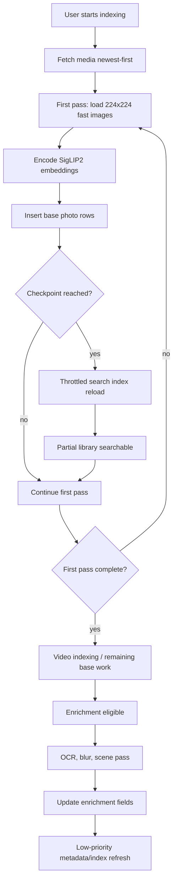
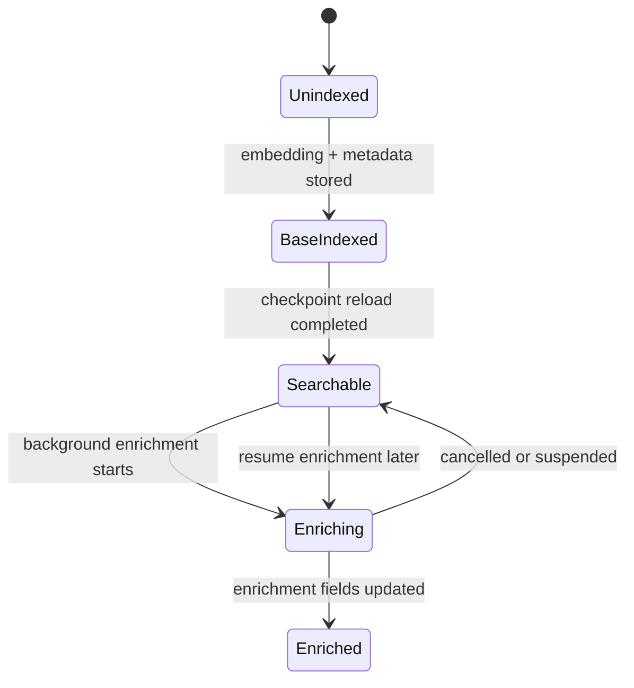

# perf: Progressive indexing and deferred enrichment

## Summary

This plan makes initial indexing produce searchable base embeddings faster, then moves slower enrichment work into a resumable background pass. It keeps the current search model and scoring behavior intact while improving perceived indexing progress for large libraries.

---

## Problem Frame

The current startup work already stages app-shell and semantic-search readiness, but first-time library indexing still does too much before each photo becomes searchable. `Memorable/Core/IndexingService.swift` loads indexing images through the same high-quality PhotoKit path used by display code, encodes a batch, then runs OCR, screenshot OCR, blur scoring, and scene classification inline before writing each `IndexedPhoto`.

For large libraries, this means searchable coverage grows more slowly than necessary. Base SigLIP2 embeddings are enough for core visual search, while OCR, scene labels, blur scores, reverse geocoding, and Surprise Me validation can improve quality later. The plan therefore separates "searchable" from "fully enriched" and updates the UI to make that distinction visible.

The pasted external spec was directionally useful but over-specified risky details. This plan does not require incremental GPU append, does not use a fixed 1,000-photo threshold, and does not change search thresholds, model architecture, or scoring semantics.

---

## Requirements

**Fast Searchable Coverage**

- R1. Indexing uses a fast, indexing-only PhotoKit image-loading path while preserving high-quality loading for user-facing display and Quick Look.
- R2. The first pass stores base embeddings and basic metadata without waiting for OCR, blur scoring, scene labels, reverse geocoding, captions, or Surprise Me validation.
- R3. Search becomes available against the partially indexed library once the first configured searchable checkpoint is reached.
- R4. Progressive search checkpoints respect the current free-tier media limit and do not assume a fixed 1,000-photo threshold.
- R5. New indexed batches become searchable without requiring app restart or full re-index.

**Deferred Enrichment**

- R6. OCR, screenshot OCR, blur scoring, and scene classification move into a cancellable and resumable enrichment pass.
- R7. Enrichment state is persisted per photo so interrupted enrichment can resume without redoing completed rows.
- R8. Enrichment does not run while first-pass photo embedding work is still active, and it avoids competing with user-initiated search.
- R9. Search behavior remains valid when enrichment fields are missing; missing OCR or scene labels simply means those boosts are absent until enrichment lands.

**Progress and Reliability**

- R10. Indexing progress shows indexed count, searchable count, total count, phase, speed, and estimated time remaining where the estimate is reliable enough to show.
- R11. The search UI tells the user when search is available against a partial library and when indexing or enrichment is still continuing.
- R12. Index reloads after progressive checkpoints are throttled so they do not rebuild the GPU index after every small batch.
- R13. Memory warnings and cancellation stop or defer non-critical work before they compromise shell or search responsiveness.

**Scope Preservation**

- R14. Search scoring thresholds, prompt behavior, model files, and text/image embedding semantics stay unchanged.
- R15. User photos, videos, queries, embeddings, and enrichment outputs remain on device.

---

## Key Technical Decisions

- **Use an indexing-specific image loader.** `PhotoLibrary.loadImage(for:)` is used by indexing and some user-facing paths today, so changing it globally risks lowering display quality. The plan adds an indexing-only loader or request-options seam that uses `.fastFormat` only for 224x224 embedding inputs.
- **Make base embeddings the first-pass contract.** First-pass records should include identifier, date, GPS coordinates, dimensions, source metadata, and embedding. Enrichment fields can be nil until the second pass updates them.
- **Persist enrichment completion directly.** A boolean or status column is clearer than inferring completion from nullable fields because legitimate OCR or scene-label results can be empty.
- **Reload at milestones, not append GPU state per batch.** `GPUSimilaritySearch` caches an MPS graph shaped by embedding count. Rebuilding at meaningful checkpoints is simpler and safer than adding append semantics to the Metal path.
- **Use a configurable checkpoint threshold.** The first checkpoint should be based on `IndexingConfig` and capped by `FreeTier.maxIndexedMedia` for free users. This avoids the pasted spec's fixed 1,000-photo threshold, which conflicts with the current 500-media free tier.
- **Defer batch-size expansion until measurement.** Move hardcoded batch sizing to `IndexingConfig`, but keep the default at the known-working value until device profiling proves 32 or 64 is safe on A14-class hardware.
- **Add bounded prefetch after the fast-path split.** Current code parallel-loads images within one batch. A producer-consumer buffer can overlap loading the next batch with encoding the current batch, but it should be bounded and should not run multiple Core ML predictions concurrently.

---

## High-Level Technical Design

### Indexing Lifecycle

### Searchability vs. Enrichment State

---

## Implementation Units

### U1. Add Indexing Image Loading Profile

**Goal:** Separate indexing image loading from display image loading so embeddings can use `.fastFormat` without lowering user-facing image quality.

**Requirements:** R1, R14, R15.

**Dependencies:** None.

**Files:**

- `Memorable/Core/PhotoLibrary.swift`
- `Memorable/Core/IndexingService.swift`
- `MemorableTests/ImagePreprocessingTests.swift`
- `MemorableTests/IndexingPolicyTests.swift`

**Approach:** Add a dedicated indexing loader, or a testable request-options builder, that uses `.fastFormat`, `resizeMode = .exact`, `isNetworkAccessAllowed = false`, and the existing 224x224 default. Keep `loadThumbnail`, Quick Look, and full-size display paths on high-quality loading. Route only first-pass embedding and thumbnail OCR input through the indexing loader.

**Patterns to follow:** Existing `PHImageManager` continuation handling in `PhotoLibrary.loadImage(for:)`, including the non-degraded callback guard and no-network setting.

**Test scenarios:**

- Indexing request options use `.fastFormat`, `.exact`, async loading, and network-disabled behavior.
- Thumbnail/display request options continue to use high-quality delivery.
- Indexing loader keeps 224x224 as the default target size.
- Degraded PhotoKit callbacks do not resume the async result before the final image.

**Verification:** Indexing code no longer calls the generic high-quality image loader for 224x224 embedding inputs, while user-facing loaders remain unchanged.

### U2. Persist Enrichment State and Database Update APIs

**Goal:** Make enrichment resumable by adding per-photo enrichment state and update paths.

**Requirements:** R6, R7, R9, R15.

**Dependencies:** None.

**Files:**

- `Memorable/Core/DataModels.swift`
- `Memorable/Core/Database.swift`
- `MemorableTests/DatabaseTests.swift`
- `MemorableTests/SearchEngineTests.swift`

**Approach:** Add a migration that records whether photo enrichment is complete. Extend `IndexedPhoto`, `DatabaseProtocol`, and `AppDatabase` with methods to fetch unenriched photos in bounded batches and update OCR text, sharpness score, scene labels, and completion state. Keep existing nullable enrichment columns because nil remains meaningful for "not available" or "not enriched yet."

**Patterns to follow:** Existing location-backfill methods such as `photosNeedingLocationBackfill(limit:)` and `updatePhotoLocationStrings(...)`.

**Test scenarios:**

- A newly inserted base photo defaults to enrichment incomplete.
- Fetching photos needing enrichment returns only incomplete rows and respects the limit.
- Updating enrichment fields marks the row complete and preserves the embedding and basic metadata.
- An enriched row with no OCR text remains complete rather than being fetched repeatedly.
- Existing fixture databases satisfy the expanded `DatabaseProtocol` with clear no-op or fake behavior.

**Verification:** Database tests prove enrichment state survives migration, insert, fetch, and update flows.

### U3. Split Photo Indexing Into Base Pass and Enrichment Pass

**Goal:** Make photos searchable after embedding insertion without waiting for OCR, blur scoring, or scene classification.

**Requirements:** R2, R6, R8, R9, R13, R14, R15.

**Dependencies:** U1, U2.

**Files:**

- `Memorable/Core/IndexingService.swift`
- `Memorable/Core/OCRService.swift`
- `Memorable/Core/BlurDetector.swift`
- `Memorable/Core/SceneClassifier.swift`
- `MemorableTests/IndexingPolicyTests.swift`
- `MemorableTests/SearchEngineTests.swift`

**Approach:** Refactor the photo path so first-pass batch processing only loads indexing images, encodes embeddings, and inserts base `IndexedPhoto` rows with enrichment incomplete. Move the existing OCR, screenshot OCR, blur scoring, and scene classification logic into a separate enrichment worker that reads incomplete rows after base indexing has stopped competing for Core ML resources. Keep search scoring unchanged; missing OCR and scene labels are already handled as absent boosts.

**Execution note:** Characterize the current nil-enrichment search behavior before removing inline enrichment from the first pass.

**Patterns to follow:** Existing detached OCR and blur work in `IndexingService`, plus `launchGeocoding()` as a model for cancellable background follow-up work that reports progress separately.

**Test scenarios:**

- Base photo indexing inserts rows with valid embeddings and nil enrichment fields.
- Search over base-indexed rows still returns visual matches.
- OCR-heavy queries do not receive OCR boosts until enrichment updates the row.
- Enrichment worker updates OCR, sharpness, and scene fields for incomplete rows.
- Cancelling indexing cancels or defers enrichment without marking incomplete rows complete.
- A failed enrichment item remains retryable and does not corrupt the base embedding row.

**Verification:** The first-pass indexing path no longer calls OCR, full-res screenshot OCR, blur scoring, or scene classification before inserting base rows.

### U4. Add Progressive Search Checkpoints

**Goal:** Make partial photo coverage searchable during indexing without rebuilding GPU state after every batch.

**Requirements:** R3, R4, R5, R9, R11, R12, R13.

**Dependencies:** U2, U3.

**Files:**

- `Memorable/Core/AppConstants.swift`
- `Memorable/Core/IndexingService.swift`
- `Memorable/Core/SearchEngine.swift`
- `Memorable/Core/SemanticSearchRuntime.swift`
- `MemorableTests/IndexingPolicyTests.swift`
- `MemorableTests/SemanticSearchRuntimeTests.swift`
- `MemorableTests/SearchEngineTests.swift`

**Approach:** Add configuration for first searchable checkpoint, checkpoint interval, and minimum reload spacing. During first-pass indexing, reload the search index after the first checkpoint and then at throttled intervals. The first checkpoint should be capped by free-tier availability for non-Pro users. Continue to use full `SearchEngine.loadIndex()` rebuilds at checkpoints rather than modifying `GPUSimilaritySearch` append behavior.

**Patterns to follow:** Existing `reloadSearchIndex()` detached work, `FreeTier.canIndexMore(...)`, and semantic readiness callbacks added in the staged startup work.

**Test scenarios:**

- First checkpoint for a free user does not exceed `FreeTier.maxIndexedMedia`.
- Pro users use the configured first checkpoint threshold.
- Checkpoint reload marks `IndexingService.isReady` and semantic runtime index readiness.
- Multiple small batches inside the throttle window do not trigger repeated reloads.
- After a checkpoint reload, search runs against the partial index.
- Final photo pass completion performs a final reload even if the last checkpoint was recent.

**Verification:** A user can search partial indexed media during a long photo pass, and reload frequency is bounded by configuration.

### U5. Improve Indexing Progress UX

**Goal:** Show users what is searchable now, what is still indexing, and roughly how long the current phase will take.

**Requirements:** R10, R11, R13.

**Dependencies:** U4.

**Files:**

- `Memorable/Core/DataModels.swift`
- `Memorable/Core/IndexingService.swift`
- `Memorable/Views/IndexingBannerView.swift`
- `Memorable/Views/SearchView.swift`
- `MemorableTests/IndexingPolicyTests.swift`

**Approach:** Extend `IndexingProgress` with searchable count, phase start time or derived speed, and optional ETA. Keep ETA hidden until there is enough completed work to avoid misleading early estimates. Update the banner copy to distinguish first-pass indexing, partial-search availability, video indexing, enrichment, and reverse-geocoding. Keep the UI non-blocking and preserve the Stop action.

**Patterns to follow:** Current `IndexingBannerView` percent/progress-bar layout and `geocodingProgressStrip` for slim background-work reporting.

**Test scenarios:**

- Progress percentage remains correct for the active phase.
- Speed is nil or hidden before enough items complete.
- ETA is nil or hidden when total is unknown or no progress has completed.
- Searchable count updates when checkpoint reloads complete.
- Banner copy says partial search is available only after the index has actually reloaded.
- Enrichment progress does not imply additional base media are becoming searchable.

**Verification:** UI copy and progress values reflect the difference between indexed, searchable, enriched, and remaining work.

### U6. Add Bounded Prefetching and Batch-Size Configuration

**Goal:** Overlap PhotoKit image loading with Core ML encoding without increasing Neural Engine contention or memory risk.

**Requirements:** R1, R2, R5, R12, R13, R14.

**Dependencies:** U1, U3, U4.

**Files:**

- `Memorable/Core/AppConstants.swift`
- `Memorable/Core/IndexingService.swift`
- `MemorableTests/IndexingPolicyTests.swift`

**Approach:** Replace the local hardcoded `encodeBatchSize = 16` with `IndexingConfig.batchEncodeSize`. Add a bounded producer-consumer flow that keeps at most one or two loaded batches ahead of encoding. Keep Core ML prediction single-consumer. Default batch size should remain the known-working value until device profiling proves a larger size is safe.

**Patterns to follow:** Existing task-group image loading in `IndexingService` and `Task.yield()` usage during long indexing loops.

**Test scenarios:**

- Batch-size policy reads from `IndexingConfig`.
- Prefetch buffer never exceeds the configured capacity.
- Cancelling indexing stops producer and consumer tasks.
- Failed image loads are skipped without blocking later batches.
- Encoding order remains deterministic enough for progress and checkpoint accounting.

**Verification:** The indexing loop can overlap loading and encoding while keeping memory bounded and avoiding concurrent Core ML predictions.

### U7. Documentation and Verification Coverage

**Goal:** Keep the implementation reviewable and preserve the product's privacy and scoring constraints.

**Requirements:** R14, R15.

**Dependencies:** U1, U2, U3, U4, U5, U6.

**Files:**

- `README.md`
- `SEARCH_SCORING.md`
- `docs/changes/startup-search-performance-summary.md`
- `MemorableTests/IndexingPolicyTests.swift`
- `MemorableTests/DatabaseTests.swift`
- `MemorableTests/SearchEngineTests.swift`

**Approach:** Update docs to explain the distinction between base searchable embeddings and deferred enrichment. Document that scoring thresholds and model behavior are unchanged. Add or update tests that prove base-indexed rows are searchable before enrichment and that missing enrichment data does not crash or silently change threshold behavior.

**Patterns to follow:** Existing `SEARCH_SCORING.md` local-only language and the before/after summary style in `docs/changes/startup-search-performance-summary.md`.

**Test scenarios:**

- Search over base-only rows returns results when embedding similarity passes the existing threshold.
- Missing OCR and scene labels do not crash scoring.
- Enriched rows can receive OCR or scene boosts through the existing scoring path.
- Documentation describes deferred enrichment without implying remote processing.

**Verification:** Documentation, tests, and implementation all describe the same staged indexing lifecycle.

---

## Acceptance Examples

- AE1. Partial search becomes available during a long photo pass
  - **Covers:** R3, R4, R5, R11, R12.
  - **Given:** A Pro user starts indexing a large library.
  - **When:** The first configured checkpoint is inserted and the throttled index reload completes.
  - **Then:** Search runs against the indexed subset while the remaining library continues indexing.

- AE2. Free-tier checkpoint respects media limits
  - **Covers:** R3, R4.
  - **Given:** A free user can index up to `FreeTier.maxIndexedMedia`.
  - **When:** Progressive indexing chooses the first searchable checkpoint.
  - **Then:** The checkpoint does not exceed the free-tier indexed media limit.

- AE3. Base indexing does not wait for enrichment
  - **Covers:** R2, R6, R9.
  - **Given:** A photo has been loaded and encoded.
  - **When:** The base row is inserted.
  - **Then:** The row is eligible for visual search before OCR, blur scoring, or scene classification has completed.

- AE4. Enrichment resumes after interruption
  - **Covers:** R6, R7, R8.
  - **Given:** Enrichment is interrupted halfway through a batch.
  - **When:** The app later resumes enrichment.
  - **Then:** Completed rows are skipped and incomplete rows are retried.

- AE5. Display quality is not downgraded
  - **Covers:** R1, R14.
  - **Given:** Indexing uses fast 224x224 image loading.
  - **When:** The user opens a search result or Quick Look preview.
  - **Then:** User-facing display paths still request high-quality image data.

---

## Scope Boundaries

### In Scope

- Indexing-only `.fastFormat` image loading.
- First-pass base embedding insertion.
- Resumable photo enrichment for OCR, screenshot OCR, blur scoring, and scene labels.
- Progressive checkpoint index reloads.
- Progress UI that distinguishes searchable and enriching work.
- Bounded prefetching and config-driven batch size.

### Deferred to Follow-Up Work

- Raising the default batch size above 16 after profiling on A14-class devices.
- `BGProcessingTask` support for longer background indexing windows.
- Approximate nearest-neighbor search for very large indexes.
- True incremental Metal/GPU append support.
- Model compression, model replacement, or packaging changes.

### Out of Scope

- Search scoring threshold changes.
- Prompt-template changes.
- Remote photo processing, remote query processing, or remote embedding generation.
- Auto-starting first-time indexing on app launch without user intent.

---

## System-Wide Impact

This plan changes the lifecycle of indexed photos. A photo can be unindexed, base-indexed and searchable, or fully enriched. Search must remain correct in all three states, and UI copy must stop implying that all searchable media are fully enriched.

The database gains persistent enrichment state, so migrations and fixture databases must be updated carefully. The search engine should not require enrichment fields to exist, and background enrichment should not compete with user-initiated search or active first-pass indexing.

---

## Risks and Mitigations

- **Risk: More frequent index reloads could hurt indexing throughput.** Mitigate with explicit checkpoint thresholds and minimum reload spacing.
- **Risk: Deferred OCR temporarily lowers text-heavy screenshot recall.** Mitigate by making progress copy clear and by scheduling enrichment promptly after base indexing is idle.
- **Risk: Database migration mistakes could mark rows as permanently enriched or permanently pending.** Mitigate with migration tests covering old rows, new base rows, empty OCR outcomes, and retries.
- **Risk: `.fastFormat` could affect embedding quality on some assets.** Mitigate by keeping the change indexing-only and validating with visual-query spot checks or the existing search evaluation harness before widening scope.
- **Risk: Prefetching can increase memory pressure.** Mitigate with a bounded buffer, conservative defaults, cancellation propagation, and memory-warning behavior that pauses enrichment first.

---

## Sources and Research

- `docs/brainstorms/2026-06-06-performance-size-search-optimization-requirements.md` requires base embeddings to become searchable before enrichment work runs.
- `Memorable/Core/IndexingService.swift` currently loads images in parallel per batch, encodes them, then runs OCR, screenshot OCR, blur scoring, and scene classification inline before inserting photo rows.
- `Memorable/Core/PhotoLibrary.swift` currently uses `.highQualityFormat` in the generic image loader used by indexing.
- `Memorable/Core/AppConstants.swift` defines `IndexingConfig.batchEncodeSize`, but `IndexingService` still hardcodes `encodeBatchSize = 16`.
- `Memorable/Core/GPUSimilaritySearch.swift` builds a cached MPS graph for a fixed embedding count, which is why checkpoint reloads are preferred over incremental append in this plan.
- `Memorable/Core/Database.swift` already has location-backfill fetch/update patterns that the enrichment fetch/update APIs should mirror.
- `Memorable/Views/IndexingBannerView.swift` already displays indexing phase, percentage, completed count, total count, and Stop action.
