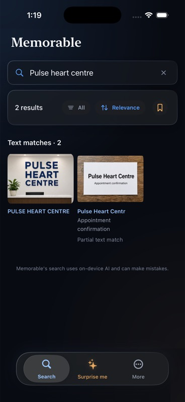
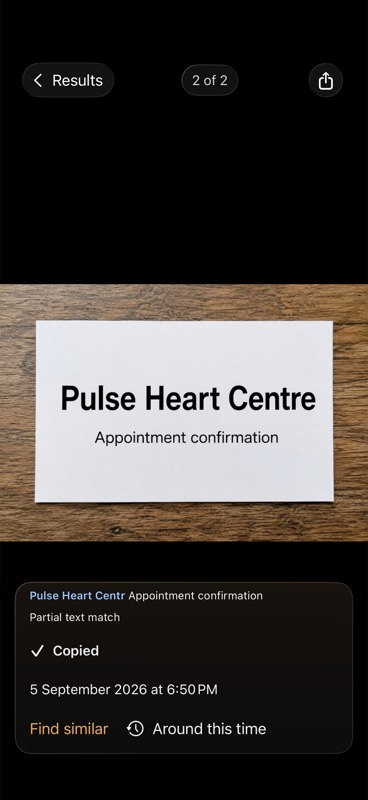
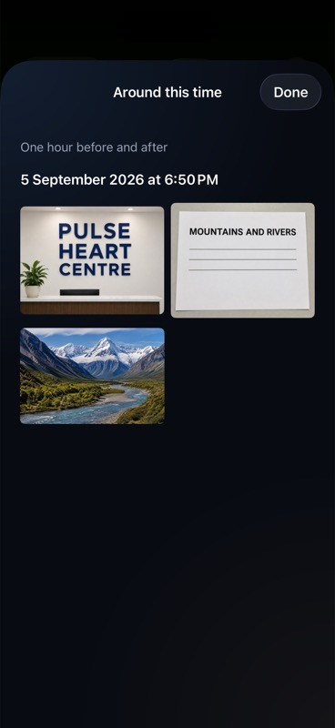
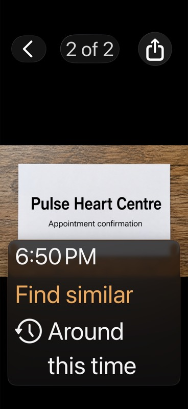

# Search and photo exploration verification

Verified on September 6, 2026, using the existing iPhone simulator library of 2,010 indexed photos. Its photos and index were preserved.

## Behavior checked

- `pulse heart centre`: two text results. The complete sign ranks first; the appointment card's `Pulse Heart Centr` is labeled **Partial text match**. Both display highlighted excerpts.
- **Copy text**: the simulator clipboard contains `Pulse Heart Centr Appointment confirmation`, including text beyond the highlighted phrase. The button changes to **Copied**. UIKit's `localOnly` option disables Universal Clipboard.
- Swiping to the sign replaces the excerpt with `PULSE HEART CENTRE` and restores **Copy text**.
- **Around this time**: opens the other three fixtures photographed nearby. Opening one enters the photo viewer. Results use stored dates within one hour before or after the selected photo, capped at the 100 closest photos and displayed chronologically.
- Largest accessibility text size: the top controls remain readable; the details panel scrolls to **Copy text**, **Find similar**, and **Around this time**. The latter opens the gallery. Standard text size was restored afterward.

## Automated checks

- Full `Memorable` simulator suite: **905 passed, 0 failed, 1 skipped**. The skip is the existing opt-in dataset harness.
- Python suite: **31 passed**.
- `MemorableRelevanceTests`: **4 passed**, including the new 12-query test with real embeddings, Vision OCR, and GRDB.
- `python3 scripts/premerge.py`: **passed** signing hygiene, bundled model verification, migration safety, and relevance gates.
- Original 50-caption metrics unchanged: recall@10 **0.96**, recall@50 **0.96**, MRR **0.853333**, optional-result rate **0.26**.
- Final app build and simulator launch: **passed**.

The OCR regression first failed because the truncated card was absent, then passed with the limited matching rule. Tests also cover complete-match priority beyond a full page of partial matches, word order, short-word/number rejection, bounded excerpts, date boundaries, result caps, and folder restrictions.

## Limits

`dog` and `black cat` still return the correct fixture first only under optional closest matches. Their scores overlap a nonsense query's score, so the visual threshold remains unchanged. The benchmark records these two known misses separately; it does not count them as main-result successes. See [relevance evaluation](../../RELEVANCE_EVALUATION.md).

The OCR rule handles one missing final letter in a word of six or more letters, with at least two other exact phrase words. It does not provide general spelling correction or `center`/`centre` equivalence.

Library-coverage UI and physical-device performance work were excluded. Review and verification stayed in the current Codex task; no project material was sent to an outside reviewer.
