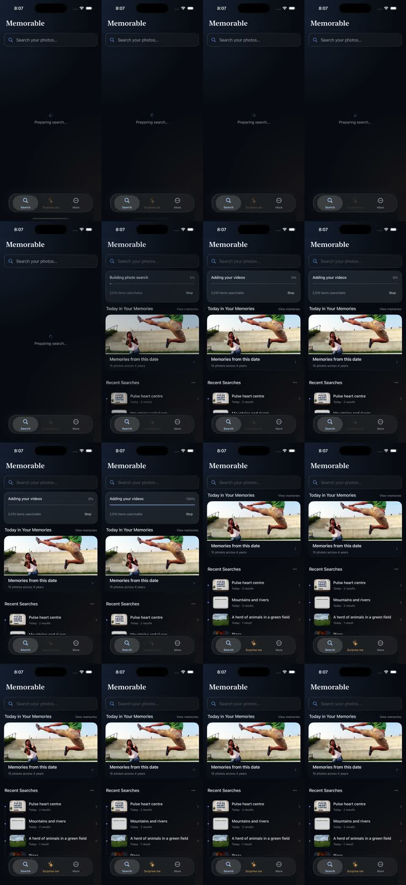

# Correctness review — 7 September 2026

Reviewed `v2` at `4b7d5b7`, including the pending indexing presentation fixes. All review stayed in this Codex task and its three built-in subagents. No project material went to outside reviewers. Existing untracked ideation files were preserved.

## Changes

| Files | Defect and correction |
| --- | --- |
| `Core/IndexingPolicies.swift`, `Core/IndexingService.swift` | Stop incorrectly certified initial completion, existing rows were treated as a completed initial scan, and rebuilds could retain conflicting flags. Completion now comes only from a successful base pass or a verified completeness check. Pending takes precedence over stale completion. A rebuild clears completion; Stop ends the current request without certifying it. Later launch or manual start resumes partial initial work. Enrichment cannot complete the base checkpoint. |
| `Core/PhotoLibraryIndexingWorker.swift` | Unrecovered reads, encodes, replacements, and writes could still certify completion. The session records failures and preserves successful partial work. Photo failures do not starve the video pass. Revoked permission cannot certify an empty library. Local-only unavailable media remains an intentional skip. |
| `Core/Database.swift` | An otherwise successful rebuild containing only unavailable local media could request another rebuild forever. Empty-pass completion now clears the marker only after checking, in the same transaction, that no incompatible embeddings remain. No migration or index wipe was added. |
| `Views/MainTabView.swift`, `Views/SearchView.swift` | Temporary warmup could remove initialized screens; incremental progress could show first-time setup or a slideshow. Initialized tabs stay mounted, initial/resumed/rebuild runs use the slideshow, and incremental work retains normal home content with compact progress. |
| `Core/SemanticSearchRuntime.swift`, `MemorableApp.swift`, `Views/SearchView.swift` | Actual index-load errors were treated as an absent index. They now expose a recoverable error and retry action. Retry reloads even if an older snapshot remains usable. |
| `Views/SearchViewModel.swift` | History persistence kept the result spinner visible; fallback results escaped availability validation; the viewer ignored filtering and sorting. Results become visible before history storage finishes, all result collections are validated with stale-result guards, and viewer order follows current filters/sort. |
| `Core/FolderIndexingWorker.swift` | Incomplete directory traversal could report success. It now reports partial completion or failure while preserving existing rows. |
| `Core/SmartQueryParser.swift` | Empty or generic successful model output could erase a valid subject. The existing deterministic parser supplies the fallback visual query. No new intent parser was introduced. |
| `Core/AppDatabase+Memories.swift` | Negative history positions could trap. Invalid positions leave history unchanged. |
| Tests, generated Xcode project, `README.md` | Added and updated regressions, registered two new test files through XcodeGen, and corrected lifecycle documentation. |

Review covered startup, foreground/background transitions, cancellation, memory pressure, search snapshots and paging, OCR and parser boundaries, database mutations, StoreKit reconciliation, folder permissions, PhotoKit callbacks, sharing, and viewer navigation. Follow-up integration review caught and corrected photo failures blocking videos and the all-unavailable rebuild edge case. Standard dependencies and generated protobuf were retained.

## Verification

`python3 scripts/release_gate.py` passed:

- 31 Python tests.
- Model, migration-safety, and relevance gates. Recall@10 and recall@50: **0.96**; MRR: **0.853333**; fallback rate: **0.26**.
- Full Debug simulator suite: **944 passed, 0 failed, 1 skipped**. The skipped test is the opt-in dataset metadata-mutation harness.
- Release entitlement suite: **1 passed**.
- Unsigned Release simulator build and Release static analysis.

The earlier focused run passed 349 tests. Preliminary targeted builds exposed test-fixture compilation errors; these were corrected before the successful runs. No test failures remain in the completed gate. Regression coverage includes persisted partial rows, Stop and relaunch, rebuild after completion, conflicting old flags, failed loads with retry, database/encoder failures, revoked and limited Photos access, folder traversal limits, delayed history storage, stale fallback validation, viewer sorting, and smart-parser omissions.

The rendered UI regression hosts **MainTabView**, not only its SearchView child, and checks home/progress through a repeated availability warmup. Screenshot attachments are included in the test bundle.

## Seeded simulator exercise

Used the current Debug build on **Memorable Release 2K**, with all **2,010 existing photos** retained. Added one reusable eight-second video fixture made from a saved simulator frame. It is still available in that simulator for future video tests.

- Cold launch loaded the existing index and automatically detected the new video.
- Incremental indexing finished in **1.1 seconds**, retaining 2,010 photos and adding one video with two indexed frames.
- The captured transition shows normal memories and recent searches throughout the progress interval, without an indexing slideshow or Build Search Index screen.
- “Pulse heart centre” returned two text matches.
- “Mountains and rivers” returned a text match, a visual photo, and the new video. The Videos filter isolated the video; playback and return to results worked.
- “Mountains,” Photos filtering, and Recent sorting retained the expected two-photo viewer sequence. The newest photo opened as **1 of 2**.

Single-run startup observations: shell **0.129 s**, semantic readiness **2.130 s**. The sampled main-thread probe recorded a **0.112 s** delay; this is not an Instruments profile or evidence of a stall-free app.

Recording: `/Users/gautam/.codex/visualizations/2026/09/04/01a06e2b-eecb-7083-9e8b-7e013209c675/incremental-indexing-verification.mp4`.

The app and recording were stopped, temporary media files removed, and simulator defaults restored. The test video and normal query history remain in the dedicated simulator. No original photos, folders, or bookmarks were removed.

## Evidence and limits

- Gate log: `/private/tmp/memorable-correctness-release-gate.log`.
- Debug result: `/Users/gautam/Library/Developer/Xcode/DerivedData/Memorable-dvcgschbksaqxsatctgpfvpbzwym/Logs/Test/Test-Memorable-2026.09.07_20-05-00-+0200.xcresult`.
- Release result: same directory, `Test-MemorableReleaseTests-2026.09.07_20-05-59-+0200.xcresult`.
- Seeded runtime logs: `/Users/gautam/Library/Developer/XcodeBuildMCP/workspaces/memorable-677c76a4ffa5/logs/com.blockdeep.memorable_oslog_2026-09-07T18-07-19-856Z_helperpid1628_ownerpid74157_3d655767.log`.

Fresh/resumed/rebuild states were exercised with isolated service/database fixtures; the existing 2K library was not erased for another full re-encode. Physical-device GPU/Neural Engine behavior, thermal pressure, battery use, and actual iOS background scheduling need device verification. Thread Sanitizer and exhaustive provider/network conditions were not exercised. The completed review and gates establish the fixes above, not a guarantee of zero possible bugs.
